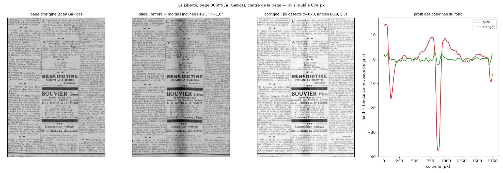

# finlam-prod

**Industrialisation du pipeline FINLAM de structuration de la presse numérisée : contrat d'échange,
conversion ALTO/METS, contrôle qualité, évaluation, service.**

Le consortium FINLAM (LITIS, TEKLIA, BnF) a produit un prototype qui segmente une page de journal en
blocs, les ordonne et les regroupe en articles ([Mocaër et al., 2026](https://arxiv.org/abs/2607.15082)).
L'article conclut que le pipeline modulaire (YOLO → séparateurs → LayoutReader → regroupeur) est celui
à déployer, et annonce sa mise en œuvre par la BnF sur plus de 8 millions de documents d'ici fin 2026.
Ce dépôt construit **ce qui vient après le prototype** : tout ce qui manque entre une sortie de modèle
et un fascicule archivable dans Gallica.

| Brique | Module | Ce qu'elle fait |
|---|---|---|
| Contrat d'échange | `pipeline/run.py` | Format JSON de sortie du pipeline (une entrée par page, zones avec classe, ordre, article), lecture/écriture, versionné |
| Conversion | `convert/alto.py`, `convert/mets.py` | JSON → ALTO 4.4 par page (classes en `LayoutTag`, articles en `StructureTag`, `ReadingOrder`) et METS par fascicule (carte de structure logique par article) ; **validés contre les XSD embarqués**, hors ligne |
| Lecture de l'existant | `data/mets_alto.py` | Relit un METS/ALTO « mode article » (le nôtre, ou celui d'Europeana Newspapers déjà dans Gallica) en structure comparable |
| Contrôle qualité | `qc/checks.py` | Détection d'incohérences sans vérité terrain : géométrie, chevauchements, texte/classe, ordre, articles, confiance, **pages à tableaux** (Neudecker & Antonacopoulos 2016), **qualité texte estimée** (Ben Salah et al. 2015) |
| Évaluation | `evaluation/finlam.py`, `evaluation/run.py` | **Les métriques du consortium** (AS@0.5 avec appariement hongrois, Jaccard article, BLEU_block) plus F1 par couples et tau de Kendall décomposé ; **IC95 % par bootstrap**, coût par page ; traçage MLflow optionnel |
| Données | `data/finlam.py`, `data/la_liberte.py`, `data/gallica.py` | Jeux FINLAM multi-titres (721 p.) et **La Liberté** (8 836 p., jeu des résultats de l'article) ; client Gallica (IIIF + ALTO) à débit limité |
| Doublure | `pipeline/rules.py`, `pipeline/ml.py` | Règles + gradient boosting produisant des sorties au bon format **en attendant celles du prototype** ; à débrancher, pas à améliorer |
| Prétraitement d'image | `preprocess/fold.py` | **Journaux pliés et scannés** : détection du pli (bande d'ombre traversante dans le fond de page), normalisation de l'éclairage, redressement de chaque moitié ; rapport sérialisable pour le QC ; **tâche `preprocess` du DAG et de `finlam-prod run`** (`preprocess/issue.py`, `FINLAM_PREPROCESS`, `preprocess.json`) ; OpenCV, CPU, ~0,5 s/page ; pli simulé à vérité connue sur page synthétique ou réelle (`preprocess/synthetic.py`) — 40/40 plis retrouvés, 0 fausse alerte sur 40 vraies pages |
| Dégauchissement appris | `preprocess/dewarp.py` | **Photo d'une page pliée en 3D / gondolée** → page à plat : UVDoc (SIGGRAPH Asia 2023, MIT, réseau repris dans `preprocess/uvdoc_net.py`, poids téléchargés et vérifiés par empreinte), CPU < 1 s ; puis le prétraitement ci-dessus ; DocTr substituable derrière la même interface (licence non commerciale) ; extra `dewarp` (torch) |
| Service | `service/api.py` | FastAPI : `POST /issues` (JSON → zip ALTO+METS+QC), `/issues/qc`, `/issues/predict` ; OpenAPI sur `/docs` ; clé d'API optionnelle, limites de taille, `/metrics` Prometheus, journal des requêtes |
| Configuration et journaux | `config.py`, `logging_utils.py` | Une seule source (`FINLAM_*`, `.env`) pour la CLI, le service et le DAG ; journaux JSON une ligne par événement en exploitation |
| Erreurs | `errors.py` | Exceptions typées par couche (`ContractError`, `DatasetError`, `GallicaError`, `ConversionError`) ; contrat JSON validé champ par champ ; CLI → une ligne et code 1, service → 422/500 |
| Versionnage des modèles | `pipeline/registry.py` | `metadata.json` à l'entraînement (version, données, empreintes SHA-256, commit, versions) ; vérification au chargement ; modèles tracés dans MLflow |
| Orchestration | `dags/finlam_pipeline.py` | DAG Airflow : fetch → **preprocess** → predict → convert → qc → archive ou relecture humaine ; le résumé QC reprend les pages pliées / inclinées |
| Analyse | `evaluation/viz.py`, `notebooks/` | Figures d'analyse d'erreurs (distributions avec IC, confusion, pages dessinées vérité terrain / prédiction) ; trois carnets : `00_cadre_evaluation` (reproduire le **cadre** de l'article : jeu, split, métriques, contrôles ; pas ses chiffres, ses modèles ne sont pas publics) `01_analyse_resultats_la_liberte` (notre apport : IC95 %, distributions, confusion, pages dessinées) et `02_pretraitement_pages_pliees` (journaux pliés : avant/après sur page synthétique, sur 40 vraies pages de La Liberté à pli simulé, fausses alertes sur les scans d'origine, sur toute image déposée dans `data/samples/`, photo d'une page pliée en 3D remise à plat par UVDoc, tâche `preprocess` sur un fascicule, et OCR avant/après contre la transcription de référence) |
| Documentation | `docs/` | DAT, installation, exploitation (configuration, sécurité, observabilité), constats sur les données, protocole de jeu gold, état de l'art, plan du rapport ANR |

## Installation et prise en main

```bash
python -m venv .venv && source .venv/bin/activate          # ou uv venv
pip install -e ".[data,service,dev]"                        # + [tracking] MLflow, [airflow] DAG, [image] OpenCV, [dewarp] torch, [ocr] tesseract
pytest                                                      # 87 tests, sans réseau ; mypy et ruff en CI

finlam-prod download --dataset la-liberte --split test      # le split de l'article (433 pages)
finlam-prod evaluate --dataset la-liberte --split test      # règles seules, métriques du consortium + IC95 %
finlam-prod download --dataset la-liberte --split validation   # 446 pages, suffit à la doublure
finlam-prod train --dataset la-liberte --split validation --models-dir models/la_liberte
finlam-prod evaluate --dataset la-liberte --split test --models-dir models/la_liberte
finlam-prod run bpt6k7155522 --pages 1,2,3 --models-dir models   # fascicule Gallica → JSON, ALTO, METS, QC
finlam-prod convert results/run/bpt6k7155522/pipeline.json  # le contrat JSON seul → ALTO/METS/QC
finlam-prod qc results/run/bpt6k7155522/mets.xml            # QC d'un METS/ALTO existant
finlam-prod compare ancien/mets.xml nouveau/mets.xml        # OLR existant vs nouveau, mêmes métriques
finlam-prod preprocess scan_plie.jpg                        # pli, éclairage, inclinaison → scan_plie_pre.png + rapport
finlam-prod dewarp photo_pliee.jpg                          # page photographiée en 3D → à plat (UVDoc) + prétraitement
finlam-prod serve                                           # http://127.0.0.1:8000/docs
jupyter lab notebooks/                                      # 00 cadre, 01 analyse d'erreurs, 02 pages pliées (extra [notebooks])
```

Quand les sorties du prototype sont disponibles : `finlam-prod evaluate --predictions dossier_json/` les
évalue à la place de la doublure, et `finlam-prod convert` les archive. Rien d'autre ne change.

## Résultats

Métriques de l'article (AS@0.5, Jaccard, BLEU_block) rapportées avec IC95 % (bootstrap sur les pages),
au format de HIPE-OCRepair (ICDAR 2026).

**La Liberté, split test de l'article (433 pages, 88 951 zones)** — les chiffres comparables :

| métrique | règles seules | doublure (règles + boosting, entraînée sur le split *val*, 446 p.) | pipeline FINLAM (article) | Arcanum (article) |
|---|---|---|---|---|
| AS@0.5 F1 | 0.264 [0.250 ; 0.276] | **0.424 [0.409 ; 0.438]** | 0.804 | 0.594 |
| AS@0.5 mIoU | 0.742 | 0.808 | — | — |
| Jaccard article | 0.716 [0.696 ; 0.734] | 0.784 [0.768 ; 0.799] | — | — |
| BLEU_block (ordre) | 0.625 [0.612 ; 0.638] | 0.625 | 0.872 | — |
| F1 par couples | 0.471 | 0.585 | — | — |
| exactitude classes / F1 macro | 0.626 / 0.395 | 0.938 / 0.674 | — | — |
| coût par page (CPU, 1 cœur) | 0.025 s | 0.089 s | 0.83 s GPU / 1.66 s CPU | — |

Lecture : la doublure, sans modèle d'image et entraînée sur 446 pages, fait la moitié du pipeline du
consortium sur la séparation d'articles et vaut le plancher attendu ; l'ordre de lecture est le même
dans les deux lignes (même découpage XY guidé par les colonnes, le boosting ne touche pas à l'ordre).
Les intervalles sur 433 pages font ± 1,5 point : c'est l'ordre de grandeur à viser pour un jeu gold
(`docs/protocole_gold.md`). Chiffres du consortium : Mocaër et al. 2026, table des résultats, même
split ; ils restent à reproduire avec leurs sorties (`--predictions`).

**Jeu FINLAM multi-titres, split test (48 pages)** — non comparable à l'article, utile pour la
largeur des intervalles :

| métrique | règles seules | doublure |
|---|---|---|
| AS@0.5 F1 | 0.188 [0.152 ; 0.232] | 0.280 [0.221 ; 0.341] |
| Jaccard article | 0.413 | 0.468 |
| BLEU_block (ordre) | 0.526 [0.484 ; 0.568] | 0.526 |
| coût par page (CPU) | 0.062 s | 0.157 s |

Ce que l'analyse des données a montré, et qui conditionne toute lecture de ces chiffres
(`docs/donnees_finlam.md`) : les zones de *La Liberté* sont des **lignes** (205 par page, 23 articles
par page), celles du multi-titres des blocs ; les coordonnées sont en fraction dans l'un, en
pourcentage dans l'autre ; dans le multi-titres, la séquence des articles de `zone_orders` est un tri
lexicographique d'identifiants, 40 % des articles n'ont pas de titre, et les polygones se touchent
bord à bord. L'article signale une vérité terrain dérivée des METS/ALTO existants et un gold
standard « en cours » ; `docs/protocole_gold.md` propose comment le constituer.

## Exploitation

Tout se règle par variables d'environnement `FINLAM_*` (ou un fichier `.env`) : chemins, clé d'API
(`FINLAM_API_KEY`, en-tête `X-API-Key`), limites de taille des requêtes, niveau et format des
journaux (`FINLAM_LOG_JSON=1`), expérience MLflow. Le service expose `/health` (version, modèle,
limites) et `/metrics` (Prometheus : requêtes par route et statut, temps cumulé, pages traitées,
erreurs QC et XSD). Les modèles entraînés portent un `metadata.json` (version, jeu, empreintes,
commit) vérifié au chargement. Détail : `docs/exploitation.md`.

Qualité du code : PEP 8 et imports par ruff, typage vérifié par mypy, 87 tests dont un bout en bout
(fascicule synthétique → doublure → contrat → ALTO/METS validés → relecture → évaluation) ; tout
tourne en CI sur Python 3.10-3.12 et en `pre-commit`.

## Prétraitement des pages pliées

Un journal plié en deux puis numérisé à plat présente une ombre le long du pli, une inclinaison
différente de chaque côté, et parfois du texte perdu dans le pli. Les deux premiers défauts se
corrigent avant l'OCR et la segmentation, sur CPU, avec OpenCV ; le troisième se signale au QC.



Le pli est cherché dans le **fond** de la page (fermeture morphologique qui efface l'encre), comme une
bande verticale qui s'écarte de la tendance et traverse les trois tiers de la hauteur ; l'image est
divisée par ce fond, ce qui gomme l'ombre et le vignettage sans toucher à l'encre ; chaque côté est
ensuite redressé de l'angle qui rend le profil des lignes le plus contrasté, par un `remap` sur
l'image entière (près du pli, un côté reprend ses pixels de l'autre côté de la coupe : aucun texte
n'est perdu, le blanc ne va qu'aux marges). Mesuré sur **40 vraies
pages de La Liberté** avec un pli simulé (vérité connue, carnet `02`) : pli retrouvé sur 40/40 (médiane
1 px), texte horizontal après correction (résiduel médian 0°, max 0,5°), et **0 fausse détection sur
les 433 scans d'origine du split test** (`scripts/find_worst_pages.py` : aucune page pliée dans ce
jeu ; les pires cas réels sont des inclinaisons jusqu'à 1,8°, corrigées, et deux pleines pages de
publicité dont la colonne vide a servi à durcir le détecteur — un pli est une ombre, pas une bande
claire). **Photo d'une page pliée en 3D** (gondolage, perspective) : hors de portée d'OpenCV seul ; le
dégauchissement appris **UVDoc** (`preprocess/dewarp.py`, `finlam-prod dewarp`) remet la page à plat
en moins d'une seconde CPU, puis le prétraitement ci-dessus enlève les ombres — démonstration sur
photo dans le carnet `02`, section 6. **Dans la chaîne** : tâche `preprocess` du DAG entre `fetch` et
`predict`, et `finlam-prod run` (`FINLAM_PREPROCESS=1` par défaut, `FINLAM_DEWARP=1` pour les photos) ;
chaque page avec image est corrigée, `preprocess.json` est écrit et le résumé QC reprend
`folded_pages` / `skewed_pages` (carnet `02`, section 7). **Le juge en aval** (section 8) : Tesseract
sur le tiers central, rappel de mots contre la transcription de référence de *La Liberté*, six pages —
origine 41,5 %, origine + normalisation d'éclairage **44,7 %** (+3,2), pliée 25,7 % (−15,8),
corrigée **30,9 %** (+5,2 : un tiers de la perte récupéré, le reste est du texte écrasé dans le pli).
La correction rend des points et n'en coûte pas ; mesure à refaire avec l'OCR de production de la BnF. Ce qui n'est pas couvert : le texte physiquement caché dans le pli.

## Choix techniques

- **Le contrat JSON est l'interface** entre le prototype (modèles, GPU) et l'archivage (conversion,
  QC, dépôt, CPU). Les deux moitiés se déploient et se testent séparément.
- **Coordonnées en pourcentage de page** dans tout le paquet ; pixels seulement à l'export.
- **Validation XSD hors ligne** : ALTO 4.4, METS 1.12 et xlink embarqués (réseau fermé possible).
- **QC sans vérité terrain** : en production il n'y a pas d'annotation ; on contrôle la cohérence, on
  route vers relecture au-dessus de seuils (`QCConfig`), et deux règles viennent de la littérature.
- **Évaluation en chaîne, jamais isolée** : l'ordre annoté encode déjà les frontières d'articles ;
  seule la chaîne complète mesure ce qu'un usager de Gallica verra.
- **Dépendances lourdes optionnelles** : le service et la conversion tournent sans torch ni GPU.

## Limites connues

vLLM et Ollama, cités dans l'offre, ne sont pas utilisés : il n'y a pas de modèle de langage dans
cette chaîne ; ils entreraient en jeu pour une post-correction OCR par LLM, hors périmètre ici.
Positions des lignes et des mots dans l'ALTO estimées par répartition dans le bloc (un ALTO de
production reprend celles de l'OCR) ; profils ALTO/METS de la BnF (`alto_bnf-v2_0`, METS BnF) non
encore appliqués ; sorties réelles du prototype non branchées ; comparaison avec l'OLR d'Europeana
Newspapers outillée (`compare`) mais non exécutée faute d'accès au jeu FTP depuis ici.

## Licence et données

Code MIT. Jeux FINLAM : Teklia / LITIS / BnF, MIT. Documents Gallica : conditions d'utilisation BnF.
